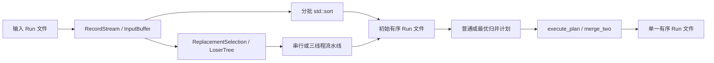

# 课程讲义

## 1. 为什么需要外存排序

数据记录不能全部放入内存时，只能分块读写磁盘。Run 是一个有序子序列；多个 Run 各自有序，不等于整个文件有序。先形成 Run，再归并，才能在有限记录内存下完成排序。

课件《外存数据管理》共 85 页。本文页码为从封面开始的实际页序。第 75–76 页要求 Week 3 文件组织、InputBuffer、OutputBuffer、Scan、Put、Search；第 77 页要求 Week 4 归并树与外排序；第 78 页要求 Week 5 Thread、join、Loser Tree、置换选择、最优归并树。第 79–80 页的动态调度及并行 K 路归并属于后续周。

## 2. 文件格式（编码前的设计）

按课件第 28 页采用 Header、Directory、Data 三段。以下字段宽度、字节序、ID 和接口语义是工程选择，课件未规定这些细节。

- 记录为有符号 32 位整数，磁盘使用小端序；不直接写 C++ struct，避免填充字节和机器布局影响。
- Header 固定 48 字节：8 字节标识 `EXRUN001`，随后 5 个 uint64：最大 Run 数、当前 Run 数、目录起点、数据起点、数据末尾（开区间）。
- Directory 每项 32 字节：uint64 的 Run ID、记录数、数据字节偏移、数据字节数。ID 从 0 开始，依次递增。预留最大 Run 数对应的目录空间。
- Data 按 Run 顺序紧密存储，允许空 Run；运行时只保存目录元数据和有限数据块，不把全部记录读入内存。
- 新文件采用显式创建，已有路径不覆盖；写入按 Run 追加，只能一个 Run 接一个 Run。必须显式完成文件，读者才接受它。数据不排序也可存储，排序是上层算法的职责。
- Scan 顺序取下一条，EOF 返回 false；Put 向当前 Run 追加一个值；Search 顺序查找某 Run 中首次等于目标的记录下标，未找到返回空结果。Search 不要求输入有序。

例：容量 2，Run0=[1,4,4]，Run1=[2]。目录起点 48，数据起点 112。两项分别为 `(0,3,112,12)`、`(1,1,124,4)`；末尾为 128。文件里的 Data 与内存缓冲区不同，缓冲区只是暂时持有其中几条记录。

损坏检查：标识、文件大小、目录数量、ID、连续偏移和记录数与字节数的一致性。此格式不提供校验和，不能发现所有合法范围内的数值位翻转；也不提供崩溃恢复或并发写入。

## 3. Week 3：类如何协作

[文件类型定义](../include/external/run_file.h)、[文件验证实现](../src/run_file.cpp#L44)、[缓冲区定义](../include/external/buffer.h)、[Scan 实现](../src/buffer.cpp#L10)。

| 类型 | 重要成员 | 职责 |
|---|---|---|
| FileHeader | max_runs、run_count、directory_offset、data_start_offset、data_end_offset | 记录文件总体布局，偏移单位为字节 |
| RunInfo | id、record_count、data_offset、data_bytes | 描述一个 Run，不存实际记录 |
| RunFile | stream_、header_、runs_ | 打开并验证文件，按 Run 和记录偏移读取块 |
| RunWriter | stream_、header_、current_run_、run_open_、finished_ | 顺序建立 Run 并写目录，显式完成文件 |
| InputBuffer | file_、run_id_、values_、next_record_、position_、buffered_count_ | 保存有限记录；缓存用完再读下一块 |
| OutputBuffer | writer_、values_、buffered_count_ | Put 暂存，满块或显式 flush 时写出 |

`read_block(run_id, record_offset, values, capacity)` 中 record_offset 是记录下标，转换成文件位置时乘以 4。RunFile 不保留调用者的数组。读到 Run 末尾返回 0；非法 ID 或越界偏移抛异常。

`InputBuffer::Scan` 先判断 `position_ == buffered_count_`。相等表示缓存用完，并不一定是文件结束；补读后仍为 0 才返回 false。缓冲区绑定文件引用，所以文件对象必须活得更久。多个 InputBuffer 可顺序共享 RunFile，因为每次 read_block 都显式定位；不可跨线程共享同一个文件流。

`OutputBuffer::Put` 在内存写一条，满了调用 flush。最后不足一块也必须 flush，否则没有写盘。析构函数不替你完成写入，因为析构中的 I/O 错误难以可靠报告。标准文件流自身也有内部缓存，此处的块是算法可控的数据缓冲。

[Week 3 Demo](../apps/week3_demo.cpp) 的完整调用顺序是：RunWriter → OutputBuffer → begin_run → 多次 Put → flush → end_run；重复建立 Run；finish 关闭写流；RunFile 验证；display 通过 InputBuffer::Scan 显示；Search 再从头扫描指定 Run。Search 返回 `optional<uint64_t>`：0 是有效命中位置，空值才表示不存在。

RunWriter 的 `finish` 才把 `PENDING!` 改成有效标识。异常退出可能留下无效文件，调用者应检查错误并使用新的输出路径。此选择使中断容易识别，但不提供事务或掉电原子性。测试使用小数据集验证行为，参见 [Week 3 测试](../tests/week3_tests.cpp)。测试断言用普通异常检查，Release 下也会执行，不依赖可能被禁用的 assert。

## 4. Week 4：先分批排序，再执行归并树

先手算输入 `[8,3,7,1,6,2,5,4]`，内排容量 M=3：分批排序得到 R0=[3,7,8]、R1=[1,2,6]、R2=[4,5]。合并 R0 和 R1 得到 [1,2,3,6,7,8]，再与 R2 合并得到 [1,2,3,4,5,6,7,8]。注意这里只在每个大小不超过 M 的批次上调用 std::sort。

[初始 Run 生成](../src/run_generation.cpp) 使用 [RecordStream](../include/external/run_generation.h) 将输入文件的多个 Run 按顺序串接，遇到空 Run 自动跳过。RecordStream 内部复用 InputBuffer，不自行重写文件格式。generate_runs 的输入文件不变，输出是新文件。内存包含 M 条内排记录、输入输出各 B 条缓冲，另加 O(R) 目录元数据；M 不是整个进程的字节预算。std::sort 是工程选择，课件第 34 页要求批量内排但未固定具体标准库接口。

[归并类型](../include/external/merge.h)中 RunLocation 表示“文件路径 + Run ID”，因此两段可以来自同一文件，也可以来自不同文件。MergePlanNode 的 left/right 是结点下标，均为 -1 表示叶子；sequence_length 是子树最终记录数；estimated_cost 是该子树累计输出记录数；status 表示是否已完成；source 指向叶子输入，output_path 记录内部结点输出。

[merge_two](../src/merge.cpp) 保留两个当前值及有效标记。条件 `!has_right || (has_left && left_value <= right_value)` 表示右边耗尽，或左值不大于右值，就输出左值并只推进左输入。否则推进右输入。相等时取左，重复值不会被去重。无效标记独立于数值，所以 INT_MAX 也可以是合法记录。每个输入还检查单调性，发现无序会报错，不把错误输入默默当作合法 Run。

课件第 36–38 页规定严格二叉树及先子后父执行。这里 `balanced_plan` 按相邻两段配对，奇数段直接提升到下一层；这是普通计划的工程选择。内部结点始终有两个孩子，没有伪造的单孩子归并。`execute_node` 先递归完成左、右子树，再调用 merge_two；内部结果写新文件，合并后回收孩子的临时输出。叶子输入文件始终保留。所有 Run 都为空时仍可归并；没有初始 Run 时 execute_plan 创建一个空 Run；只有一个 Run 时复制到新的结果文件。

`execute_plan` 校验父子关系，要求孩子下标小于父结点，防止循环、重复引用和孤立结点。工作目录必须不存在，由本次调用独占创建；成功或异常都会清理它。最终输出若写入失败可能残留未完成文件，不能当成成功结果。递归深度等于树高，课程规模使用递归便于对应第 38 页伪代码；极端巨大、偏斜的树需要进一步改为显式栈。

普通平衡归并的记录处理量为 O(N log R)，初始内排 O(N log M)；每层归并约读 N、写 N 条。estimated_cost 只统计输出记录，乘 2 可估计读写记录量，乘 8 可估计读写数据字节量，不计目录、头部和文件系统缓存，不能当作真实磁盘 I/O 次数。目录和计划占 O(R) 元数据，记录缓冲为 O(B)，没有把 N 条记录整体读入内存。[Week 4 Demo](../apps/week4_demo.cpp) 会打印三条初始 Run、成本 14 和最终结果。

## 5. Week 5：改进 Run 生成与归并计划

### 5.1 败者树 Loser Tree

[LoserTree 定义](../include/external/loser_tree.h)、[比较与重赛实现](../src/loser_tree.cpp)。叶子 entries_ 保存 value、run_number、valid；内部 losers_ 保存每场比赛失败的叶子下标，champion_ 单独保存最终冠军。leaf_count_ 补齐为二次幂，补齐叶子无效。比较顺序为有效者优先、Run 编号小者优先、值小者优先，完全相同时下标小者优先。

例：叶子 [4,1,3,2]，左半场败者为 4，右半场败者为 3，决赛败者为 2，冠军为 1。输出 1 后把它替换成 6，6 先与保存的 4 重赛，4 再与保存的 2 重赛，冠军变为 2。没有必要重新比较所有叶子。`replace_winner` 只支持替换刚输出的冠军；不能拿它更新任意叶子。建树时临时保存各子树赢家，建好后只保留败者与冠军。建树 O(M)，一次更新 O(log M)。

### 5.2 置换选择 Replacement Selection

[状态定义](../include/external/replacement_selection.h)、[实际实现](../src/replacement_selection.cpp)。ReplacementSelection 只负责 tree_；RecordStream 负责磁盘输入；SelectionOutput 负责将带编号的输出转换为 RunWriter 调用。TaggedValue 带 value 和 run_number，使输出线程也能识别段边界。

手算 M=3，输入 [4,1,3,2,6,0,5,2]。先把 [4,1,3] 放入树：

| 输出 x | 新输入 y | y 属于哪段 | 原因 |
|---|---|---|---|
| 1 | 2 | 当前段 0 | 2 ≥ 1 |
| 2 | 6 | 当前段 0 | 6 ≥ 2 |
| 3 | 0 | 下一段 1 | 0 < 3 |
| 4 | 5 | 当前段 0 | 5 ≥ 4 |
| 5 | 2 | 下一段 1 | 2 < 5 |
| 6 | EOF | 无效叶子 | 不再补入记录 |

随后段 1 输出 [0,2]。最终 R0=[1,2,3,4,5,6]，R1=[0,2]。`emit` 复制冠军，然后把新输入标记为 `winner.run_number + (incoming < winner.value)`，更新败者树，再返回原冠军。编号优先于数值，因此暂存的 0 不会抢先进入当前段。它就是“冻结”的实现，不需要每次逐个解冻叶子。

课件第 41 页的“与当前段最小值比较”，结合第 59 页步骤，指本轮刚选出并输出的 x，不能理解为这一段历史上的最小值。这里按第 59 页的 `y < x` 判定。课件所说约 2M 是随机输入下的典型长度，不是保证；升序可形成一个非常长的 Run，逆序通常每段 M 条。预留 ceil(N/M) 个目录项，足以覆盖最坏情况；数据仍按流式写出，不在内存积攒长 Run。

`load_selection` 最多加载 M 条；空输入保留无效槽位并输出 0 个 Run。SelectionOutput 在 Run 编号改变时先 flush、end_run，再 begin_run，确保不同 Run 不混在同一个未刷出的缓存里。最后 finish 完成尾段并提交文件头。串行版本 replacement_runs 保留作流水线的对照。

### 5.3 最优归并树

课件第 78 页明确要求最优归并树，没有展开构造步骤。[optimal_plan](../src/optimal_merge.cpp) 选择二路 Huffman 合并：每次取长度最短的两段，把合并长度放回最小堆。priority_queue 中每项是“长度、结点下标”；std::greater 使最短项先出来，同长度用下标确定顺序。构造 O(R log R)，生成的树复用 Week 4 的 execute_plan。

长度 [1,2,3,10]：普通配对成本为 3+13+16=32；最优顺序为 1+2=3，3+3=6，6+10=16，成本 3+6+16=25。短段可以处在深层，多合并几次；长段靠近根，减少重复搬运。最优性的交换思路：最深的一对兄弟叶子可以安排最小的两个权值而不增加成本，合并它们后归纳。结论只针对固定二路、以记录数估算搬运量的模型，不保证实际耗时最短。未要求保持等键原始顺序，本项目只排序整数，不宣称跨 Run 稳定排序。

[Week 5 测试](../tests/week5_tests.cpp) 用小规模穷举全部合并顺序验证最小成本，并实际执行计划核对结果，不仅检查一个示例数字。

### 5.4 读、算、写流水线

课件第 39–44、59–60 页描述三线程阶段同步和双缓冲；第 78 页要求 Thread/join。这里实现的是**置换选择生成 Run 的流水线**，后续归并仍调用 Week 4 的串行执行器。第 61–69、79–80 页的动态输入缓冲调度和并行 K 路归并不属于此次 Week 3–5 范围。

[流水线入口与测试故障类型](../include/external/pipeline.h)、[线程启动、join 和交换](../src/pipeline.cpp)。主线程承担计算，reader 预取下一块，output_thread 写上一块，共有三个执行线程。每一轮创建两个辅助线程，阶段末 join；此实现对应课件同步点，简单但线程反复创建有开销，不承诺比串行更快。

| 同一阶段 | 使用对象 | 不允许碰的对象 |
|---|---|---|
| 输入线程 | RecordStream、input_blocks[1-active_input] | 当前活动输入块、败者树、输出文件 |
| 主线程计算 | selection、input_blocks[active_input]、output_blocks[active_output] | 正在预取的输入块和正在写出的输出块 |
| 输出线程 | SelectionOutput、output_blocks[1-active_output] | 败者树与输入文件 |

开始先装满最多 M 条树叶，再读取第一活动输入块。正常轮次中，计算每输出一条就最多消费一条活动输入；输入线程同时填另一块；输出线程同时写前一轮的结果。`join` 全部返回后，主线程切换两个活动下标。各线程写不同对象，交换仅发生在汇合后，因此不需要 mutex 或共享队列。这里没有“无界队列偷偷积攒全文件”的情况。

EOF 后不再补入有效叶子，但树中还可能有记录，计算继续输出。最后一轮只负责写出最后一个结果块；循环条件同时检查树非空或待写块非空，避免丢尾。全部辅助线程退出后，主线程调用 SelectionOutput::finish 刷尾块并完成文件头。空输入直接形成没有 Run 的有效文件。

线程函数不能让异常直接逃逸，否则 C++ 会终止进程。因此输入、输出各用 exception_ptr 捕获异常，主线程也捕获计算或线程创建异常。无论哪个步骤失败，都先对已启动线程执行 join，然后再 rethrow_exception。线程没有互相等待的条件变量，也不会因为另一线程提前退出而永远卡在同步屏障；但真实磁盘 I/O 本身永久阻塞仍不在本项目的超时控制范围内。引用捕获 `&` 只在当前阶段使用，因为 join 在局部变量销毁之前完成。

双缓冲每边两块，加上复用文件层的输入/输出缓冲各一块，总体记录缓冲约为 6B，加上败者树 O(M)、目录 O(R)。输出块中的 TaggedValue 还带 Run 编号，不能将它简单算成 4 字节整数数组。M 和 B 都以记录数定义，没有宣称总内存精确等于 M。

PipelineTestFault 是显式的测试钩子，默认 None。用指定阶段的 Read、Compute、Write、LaunchWriter 故障验证异常传播；LaunchWriter 模拟第一个线程启动后第二个线程启动失败，检验已启动线程仍被 join。它不是业务功能或通用线程框架。

## 6. 从输入到最终结果

文件布局由 RunFile/RunWriter 负责，缓存由 InputBuffer/OutputBuffer 负责；计划只决定合并顺序，execute_plan 执行计划；流水线只安排置换选择阶段的数据传递。三份 Demo 分别展示各周入口，底层只有一份实现。

## 7. 验收时应抓住的不变式与限制

- 每个有效目录项恰好对应连续的数据范围，所有范围拼接到 data_end_offset。
- 输入缓存只读当前 Run 的剩余条数，输出缓冲有效记录数不超过容量。
- 二路归并每次输出两个段首中较小者，并且只消费一个输入，因此有序且保留重复次数。
- 置换选择始终按 `(run_number, value)` 选择最小项，小于刚输出值的新记录进入下一段。
- 流水线每轮读、算、写占用互异缓冲，join 后才交换所有权；输出排空后才 finish。

对小规模测试，独立 std::sort 结果与输出逐条一致同时证明样例的有序性、条数和重复次数，没有只用校验和代替精确比较。实际排序函数不调用读取全数据的测试助手。测试无法穷尽所有输入，但结合上述不变式可说明一般逻辑。

限制：文件元数据和归并树是 O(R) 内存，未实现超大目录分页；只处理 int32 记录；不提供并发写同一路径、掉电原子性、校验和或数据库事务；阶段线程的调度和文件系统缓存影响性能，未做性能优越性承诺。Windows 源码使用标准 C++17 和 filesystem，提供构建脚本，但当前实际验证环境是 WSL GCC，不能把它说成 MSVC 已通过。
